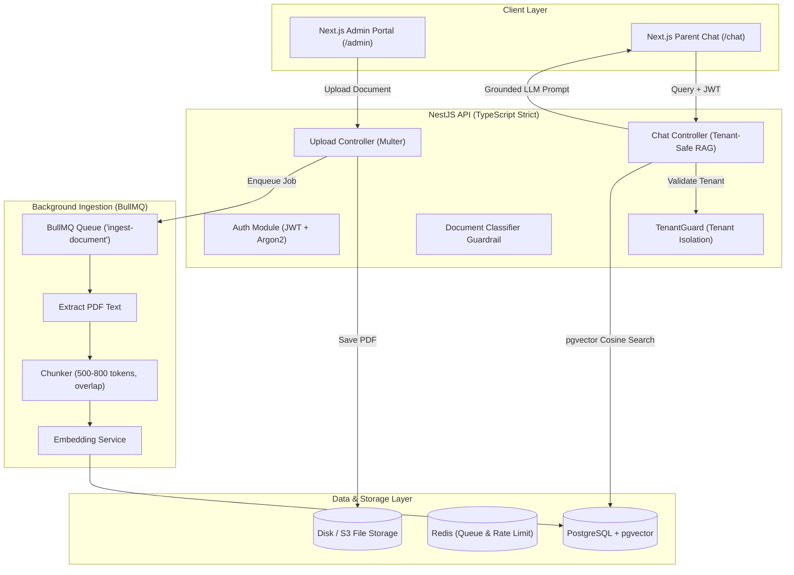

# School Helpdesk AI 🏫🤖

> Multi-tenant RAG SaaS where schools upload circulars and parents get cited, grounded answers strictly from their school's documents.

---

## 📌 1. Project Overview & Pitch

<!-- ========================================================================= -->
<!-- 🎯 [MY PART: Tu Khud Likhna]                                               -->
<!-- Write 5 lines explaining: Problem, Solution, and Core MVP scope.          -->
<!-- ========================================================================= -->
<!-- YOUR 5 LINES GO HERE:
- Problem:
- Solution:
- MVP:
-->

---

## 🏗️ 2. High-Level Architecture



---

## 🛠️ 3. Tech Stack

- **Backend API**: NestJS (TypeScript Strict Mode)
- **Database & Vectors**: PostgreSQL with `pgvector` extension
- **ORM**: Prisma
- **Queue & Ingestion**: Redis + BullMQ
- **Frontend**: Next.js 15 (App Router), React 19, Tailwind CSS
- **Containerization**: Docker Compose
- **Document Processing**: `pdf-parse` / `unpdf` + Custom Chunker

---

## 📂 4. Project Structure & File Guide

```
school-helpdesk-ai/
├── apps/
│   ├── api/                           # NestJS backend application
│   │   ├── src/
│   │   │   ├── app.controller.ts      # Health check controller exposing /health
│   │   │   ├── app.service.ts         # Service providing basic status payload
│   │   │   ├── app.module.ts          # Core module with ConfigModule and providers
│   │   │   └── main.ts                # Application bootstrapper and CORS config
│   │   ├── test/                      # E2E test suite configurations
│   │   ├── nest-cli.json              # NestJS workspace configuration
│   │   ├── tsconfig.json              # TypeScript strict configuration
│   │   └── package.json               # Backend dependencies and scripts
│   └── web/                           # Next.js App Router frontend application
│       ├── src/app/
│       │   ├── globals.css            # Global Tailwind styling rules
│       │   ├── layout.tsx             # Root layout and metadata
│       │   └── page.tsx               # Landing page placeholder
│       ├── next.config.mjs            # Next.js bundler settings
│       ├── tailwind.config.ts         # Tailwind design tokens
│       └── package.json               # Frontend dependencies and scripts
├── data/
│   └── synthetic-docs/
│       ├── greenfield-public-school/  # Synthetic circulars for Tenant A
│       └── oakridge-academy/          # Synthetic circulars for Tenant B (Isolation tests)
├── scripts/
│   └── generate-pdfs.js               # Helper script to convert .txt to .pdf
├── docker-compose.yml                 # PostgreSQL (pgvector) and Redis containers
├── .env.example                       # Reference environment variables
├── .eslintrc.json                     # Shared linter configuration
├── .prettierrc                        # Shared code formatter configuration
├── pnpm-workspace.yaml                # Monorepo workspace configuration
├── package.json                       # Root monorepo script runner
└── README.md                          # Documentation and progress tracker
```

---

## 🚀 5. Getting Started

### 1. Prerequisites
- Node.js >= 20.x
- Docker & Docker Compose (or local PostgreSQL with pgvector + Redis)

### 2. Environment Setup
```bash
cp .env.example .env
```

### 3. Spin up Infrastructure (Database & Redis)
```bash
docker compose up -d
```
Verify containers are running:
```bash
docker compose ps
```

### 4. Install Dependencies
```bash
pnpm install
# OR
npm install
```

### 5. Run Development Servers
- **Backend API (port 4000)**:
  ```bash
  npm run dev:api
  ```
- **Frontend Web (port 3000)**:
  ```bash
  npm run dev:web
  ```

---

## 🎯 6. My Part: Key Interview Questions & Defenses

<!-- ========================================================================= -->
<!-- 🎯 [MY PART: Tu Khud Likhna]                                               -->
<!-- Teen sawal likh jinke jawab tu project se interview me dena chahta hai.    -->
<!-- ========================================================================= -->
<!-- 
1. Tenant Isolation: How do we guarantee Tenant A cannot read Tenant B documents even if WHERE clause is accidentally omitted?
2. Chunking & Retrieval: Why 500-800 tokens with 15% overlap? How does it balance context vs noise?
3. Ingestion Resilience: How do we handle partial failures during embedding generation without leaving orphan rows?
-->

---

## ⚖️ 7. Design Decisions & Trade-Offs

<!-- ========================================================================= -->
<!-- 🎯 [MY PART: Tu Khud Likhna (Phase 8)]                                     -->
<!-- Explain why pgvector vs dedicated vector DB, why BullMQ, etc.             -->
<!-- ========================================================================= -->
<!-- 
- Why PostgreSQL + pgvector instead of Pinecone/Milvus?
- Why BullMQ + Redis for asynchronous ingestion?
- Why Shared Database + Tenant ID column vs Separate Schemas?
-->

---

## ⚠️ 8. Known Limitations & Scope Bounds

<!-- ========================================================================= -->
<!-- 🎯 [MY PART: Tu Khud Likhna]                                               -->
<!-- Scanned PDFs without OCR, Row Level Security roadmap, etc.                 -->
<!-- ========================================================================= -->

---

## 📋 9. 21-Session Roadmap & Done Checklist

- [x] **Phase 0: Setup (Sessions 1-2)**
  - [x] Monorepo structure (`apps/api`, `apps/web`)
  - [x] Docker compose with `pgvector/pgvector:pg16` & `redis:7-alpine`
  - [x] Synthetic documents created for Greenfield Public School & Oakridge Academy
  - [ ] **[MY PART]** Architecture diagram drawn on paper
  - [ ] **[MY PART]** Fill 5-line summary in README.md
  - [ ] **[MY PART]** Test local psql / redis-cli connection
- [ ] **Phase 1: Auth + Tenants (Sessions 3-4)**
- [ ] **Phase 2: Upload + Queue (Sessions 5-7)**
- [ ] **Phase 3: Ingestion (Sessions 8-10)**
- [ ] **Phase 4: Retrieval + Chat (Sessions 11-13)**
- [ ] **Phase 5: Guardrails (Sessions 14-15)**
- [ ] **Phase 6: Frontend (Sessions 16-17)**
- [ ] **Phase 7: Eval + Tests (Sessions 18-19)**
- [ ] **Phase 8: Deploy + Docs (Sessions 20-21)**
